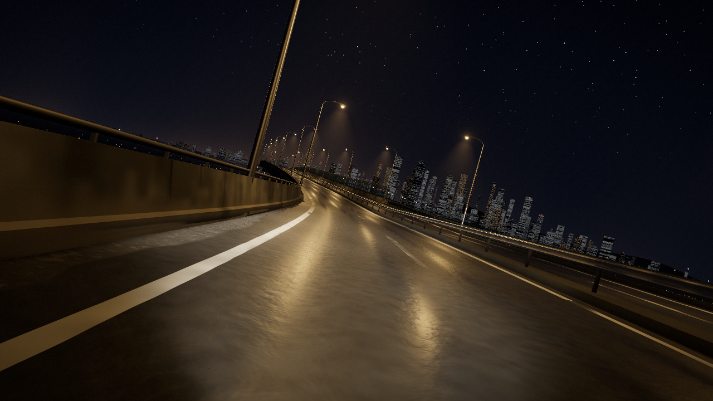

# ThreeWay respected FreeWay

1990年に発表されたNEC PC-9801用スクリーンセーバー「FreeWay」（ＦＫＳ氏作）は、ドット（点）で表現された誰もいない夜の高速道路をひたすら走るというシンプルな構成ながら、40年近くたった現在でも、当時のユーザーからは度々話題が上がるほどに心をひきつけてやまない珠玉の作品であると考えています。
「ThreeWay」は、その「FreeWay」を、最新技術であるJavascriptライブラリ「Three.js」を用い、アレンジしたものです。
スクリーンセーバーというソフトウェアジャンルすらほぼ失われた昨今、動作するのはブラウザ上とさせていただきました。
ゲーム性はありませんが、多少ユーザーが介入できるギミックやいくつかのイースターエッグ（ファンアート？）を仕込みました。
楽しんでいただけたら幸いです。

## 遊び方

`index.html` を Chrome または Edge で開くだけで動きます。
まとめてダウンロードしたい場合は、[Releases](https://github.com/mochimochi-man/ThreeWay_respected_FreeWay/releases/latest) にある ZIP（`ThreeWay_respected_FreeWay_1.0.0.zip`）をダウンロードし、展開してから中の `index.html` を開いてください。
左右のカーソルで車線移動、1-4で画質設定、Bでバイク風の動きになります。
流れる風景に飽きを感じてきたら、一つずつキーを押してみてください。
何か起こるかもしれません。

- three.js と文字のフォントをインターネットから読み込むので、インターネット接続が必要です。
- WebGL2 に対応したブラウザーが必要です。

## ライセンス
MITライセンスです。
著作権は、Mochimochi-man(X:MochimochimanEX)に帰属します。
